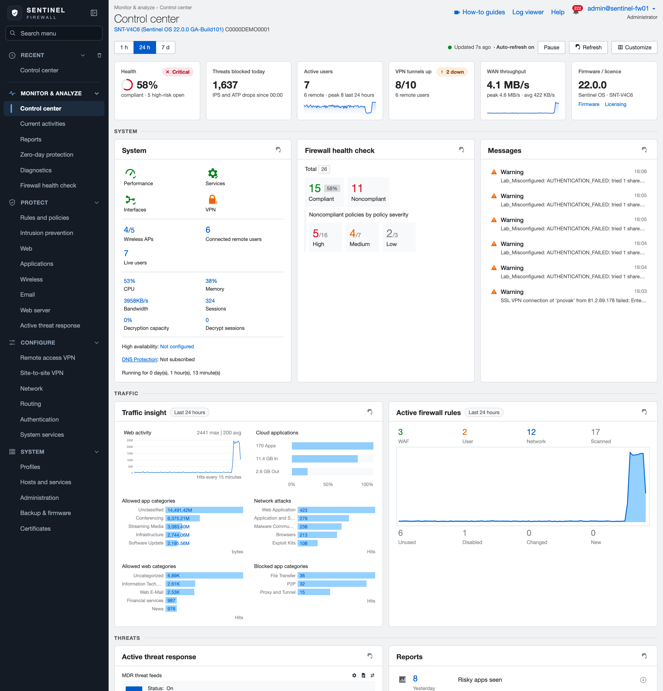
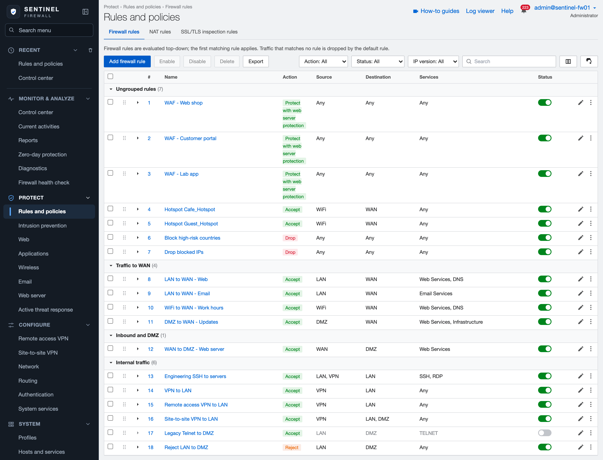
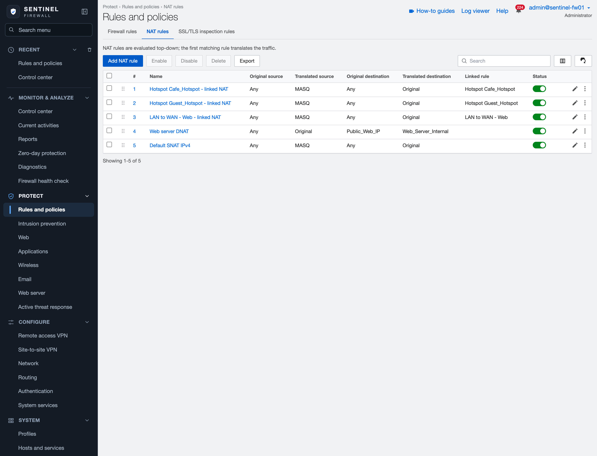
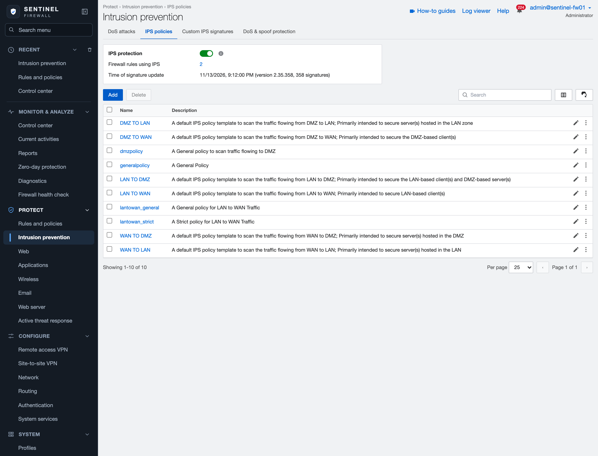
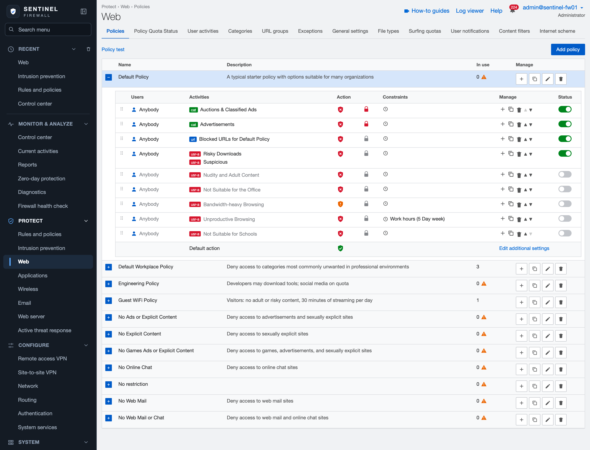
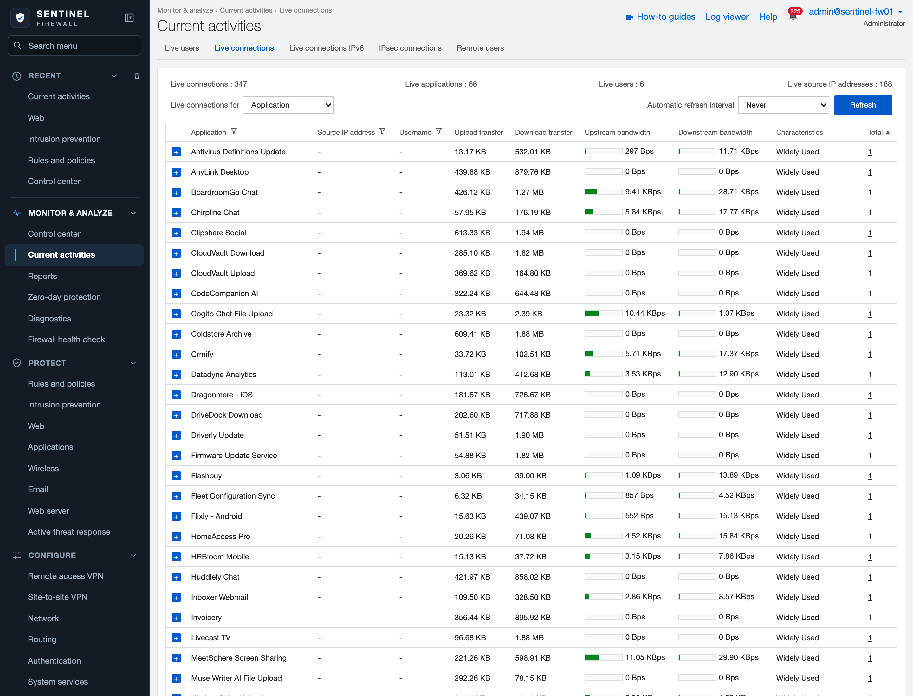
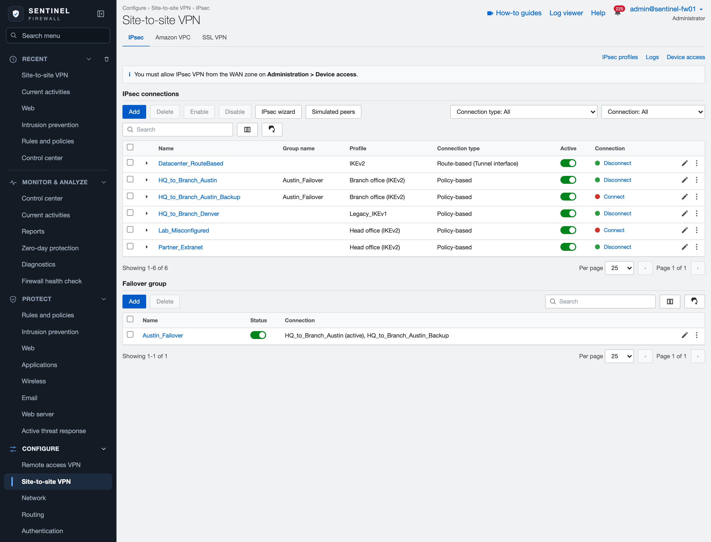
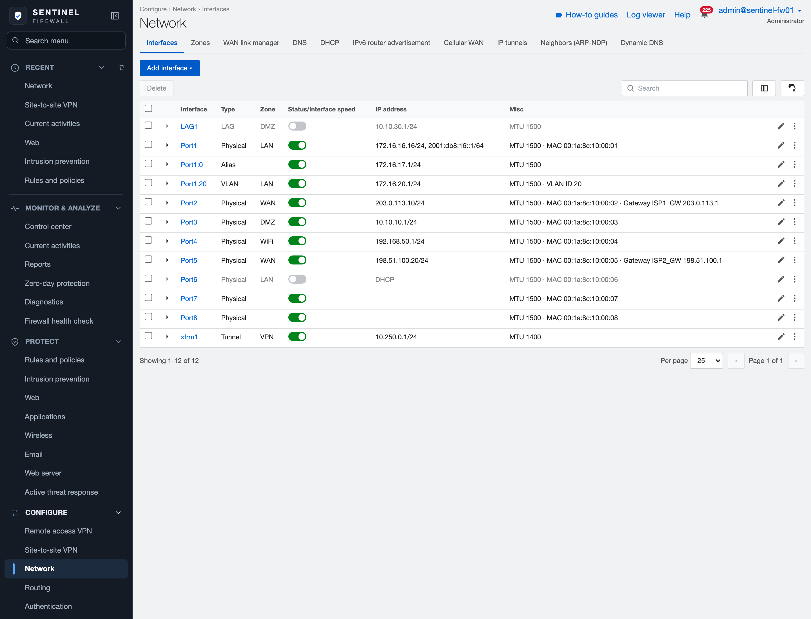
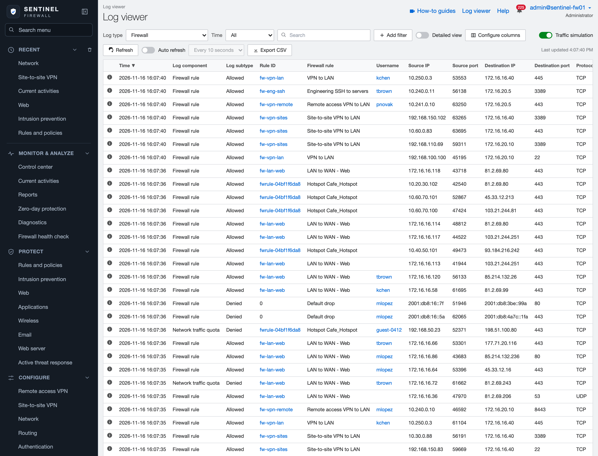

# Firewall_xxi

Screenshots of the **Sentinel Firewall** admin console: the main dashboard and the most important features.
All data shown is invented demo data and simulated traffic.

## Dashboard

## Main features

| | |
|---|---|
|  |  |
| **Firewall rules** — ordered rules in groups, with zones, networks, services and status | **NAT rules** — source NAT, port forwarding (DNAT) and linked NAT |
|  |  |
| **Intrusion prevention** — IPS policies | **Web filtering** — web policies by user, category and schedule |
|  |  |
| **Live connections** — applications, users and bandwidth in real time | **Site-to-site VPN** — IPsec tunnels |
|  |  |
| **Network** — interfaces and zones | **Log viewer** — firewall, security and system logs |

### Mobile

The sidebar becomes a slide-out drawer on phones and small screens.

## Feedback

Comments and ideas are welcome in [Discussions](../../discussions); report problems in [Issues](../../issues).
