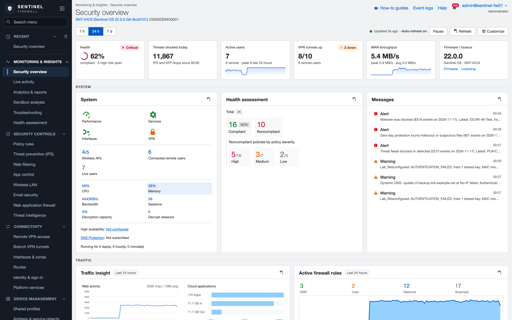
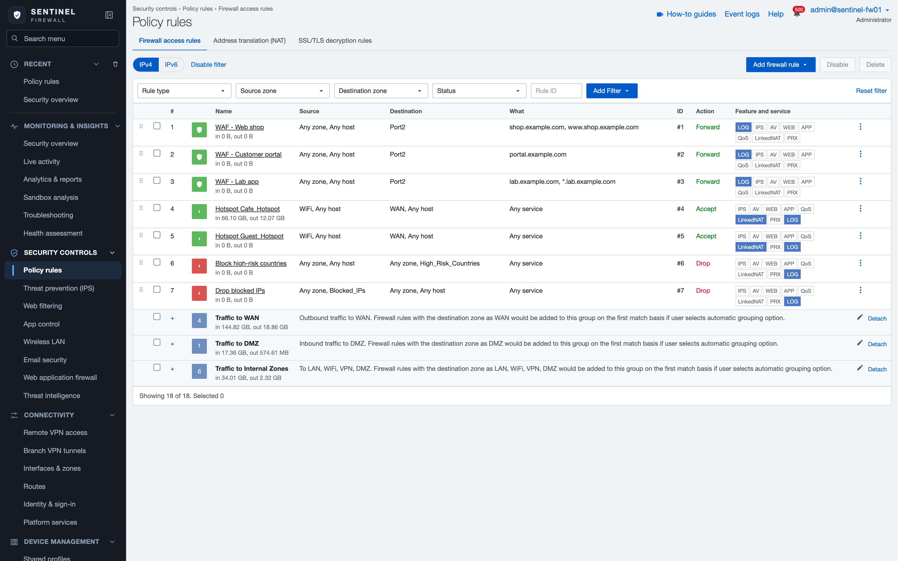
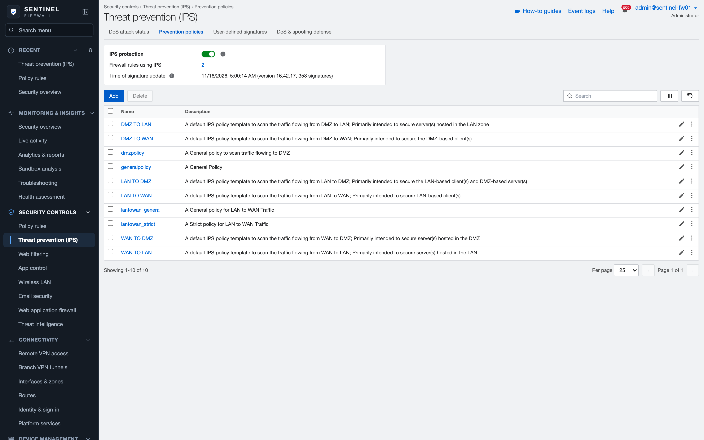
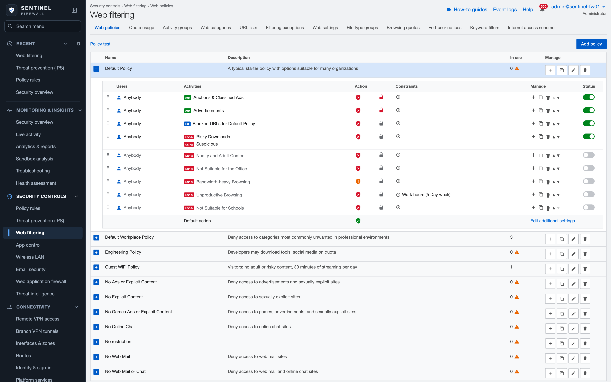
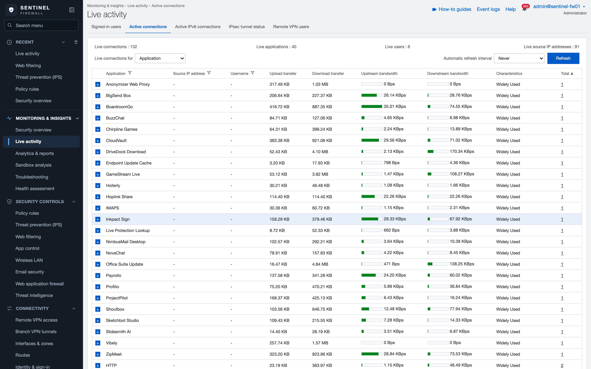
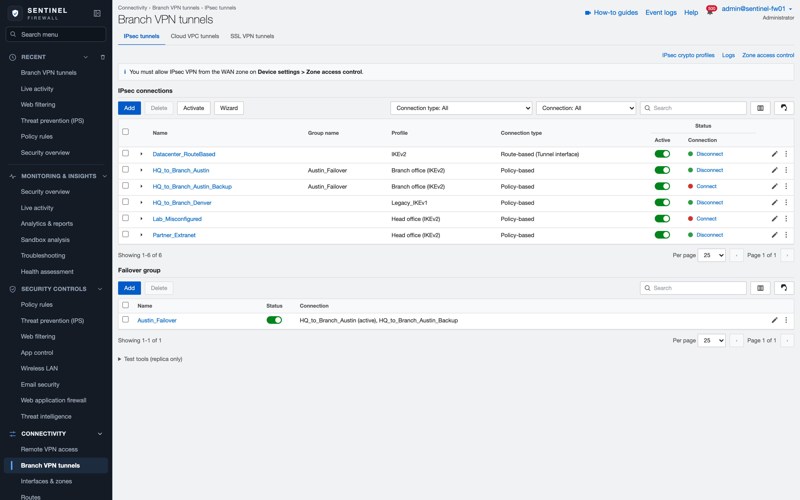
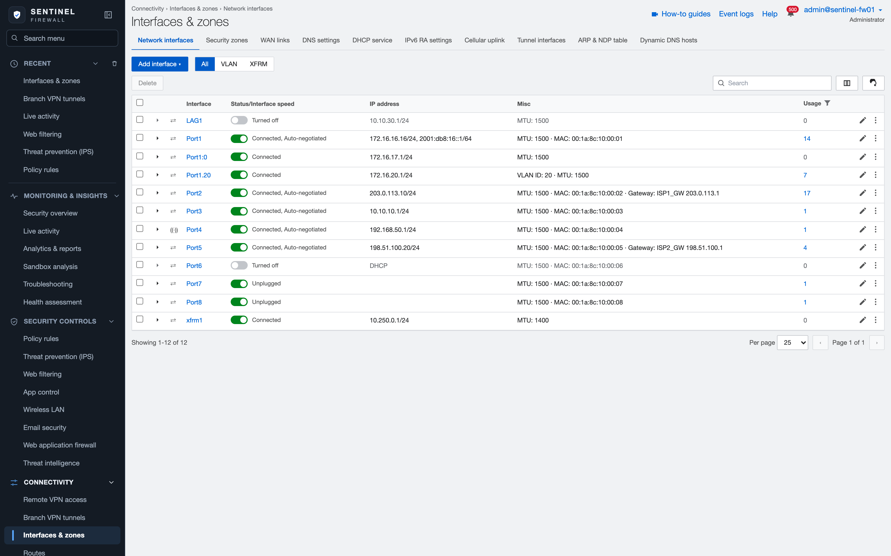
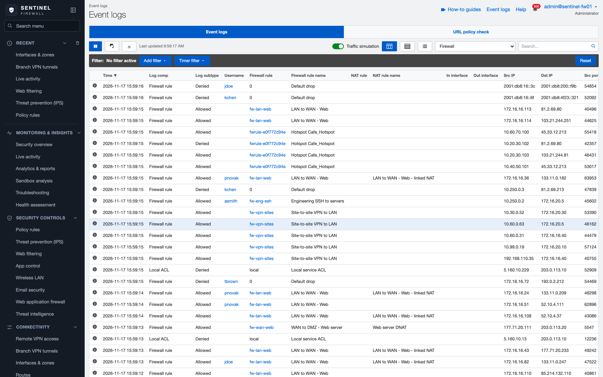
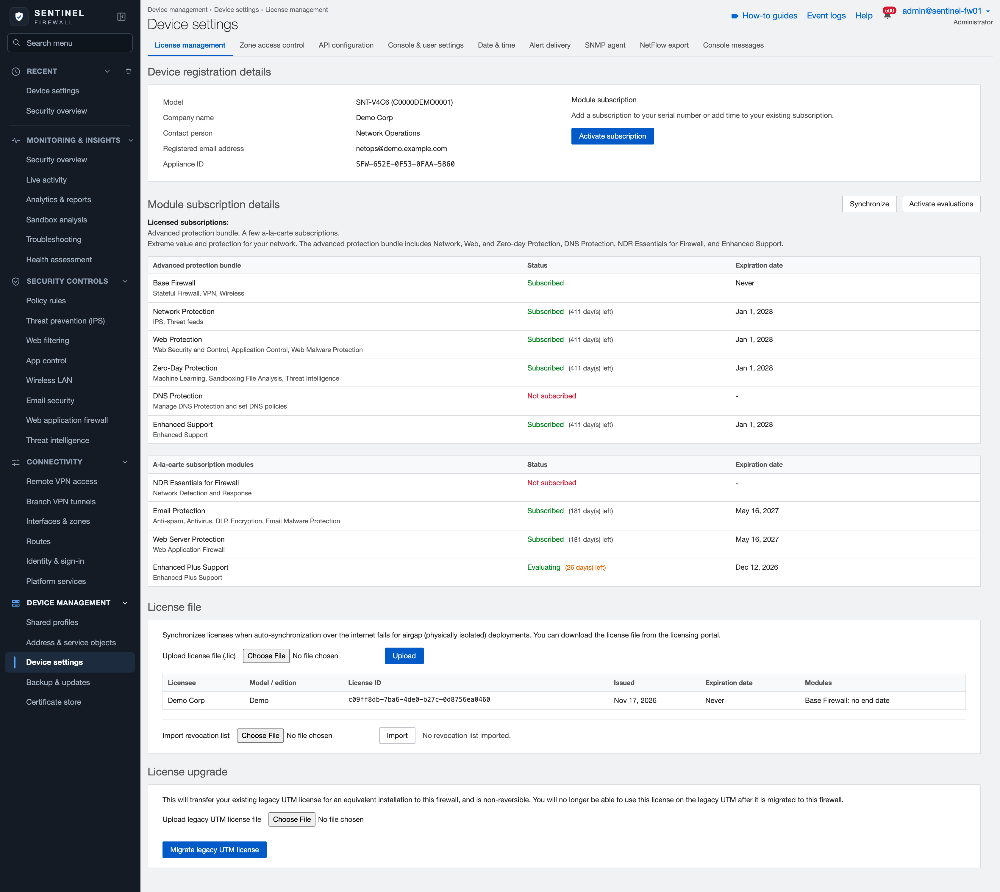
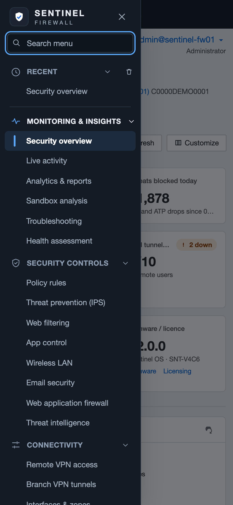

# Firewall_xxi

Screenshots of the **Sentinel Firewall** admin console: the main dashboard and the most important features.
All data shown is invented demo data and simulated traffic.

## Dashboard

## Main features

| | |
|---|---|
|  |  |
| **Policy rules** — ordered firewall rules in groups, with zones, networks, services and status | **NAT rules** — source NAT, port forwarding (DNAT) and linked NAT |
|  |  |
| **Threat prevention (IPS)** — prevention policies | **Web filtering** — web policies by user, category and schedule |
|  |  |
| **Live activity** — applications, users and bandwidth in real time | **Branch VPN tunnels** — IPsec site-to-site tunnels |
|  |  |
| **Interfaces & zones** — ports, VLANs, LAG and zones | **Event logs** — firewall, security and system logs |

### Licensing

Signed, time-based licences with per-module subscription terms, days left and the appliance ID.

### Mobile

The sidebar becomes a slide-out drawer on phones and small screens.

## Feedback

Comments and ideas are welcome in [Discussions](../../discussions); report problems in [Issues](../../issues).
