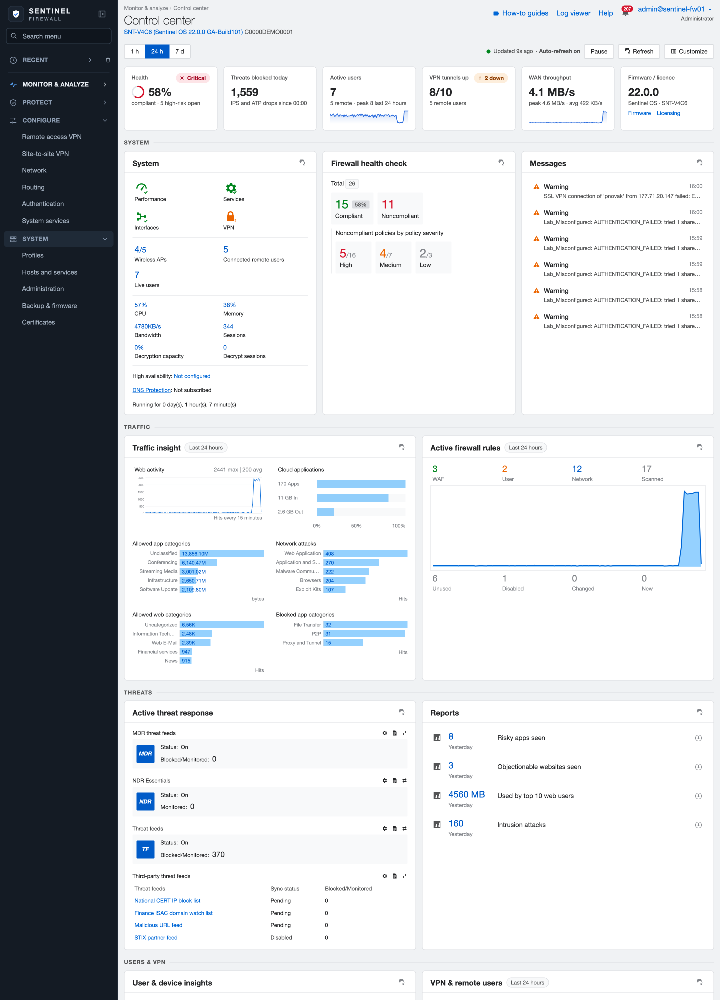
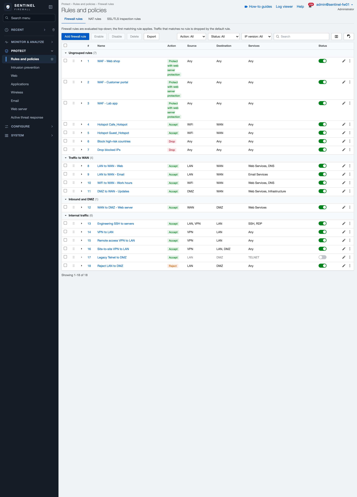
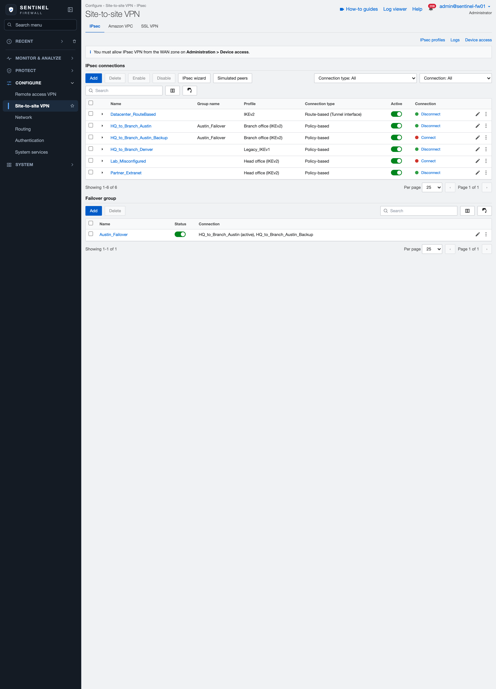
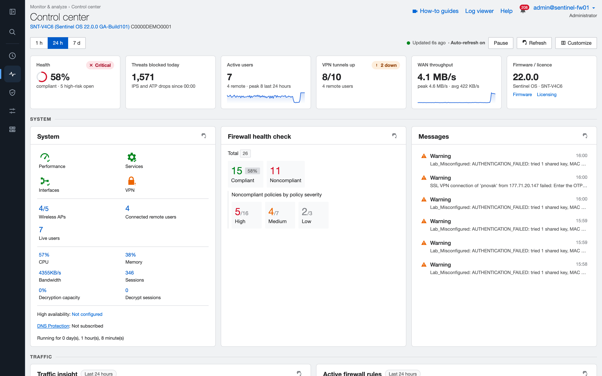

# Firewall_xxi

Screenshots of the **Sentinel Firewall** admin console — the main menu, sidebar and a few key pages.
All data shown is invented demo data.

## Screenshots

### Main menu and sidebar

| | |
|---|---|
|  |  |
| Control center — Monitor & analyze and Protect menus | Configure and System menus |
|  |  |
| Rules and policies — Firewall rules | Site-to-site VPN |
|  | |
| Compact icon-only sidebar | |

## Feedback

Comments and ideas are welcome in [Discussions](../../discussions); report problems in [Issues](../../issues).
